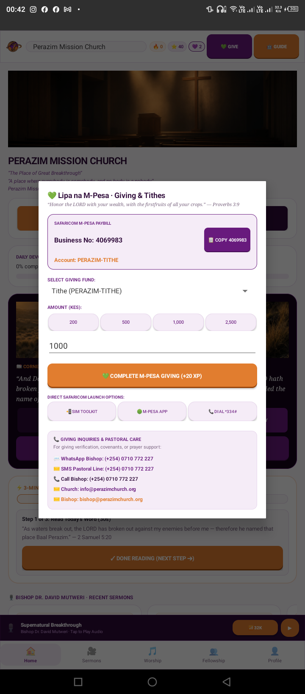
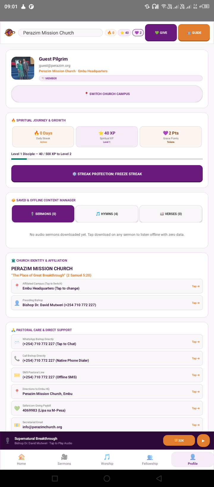
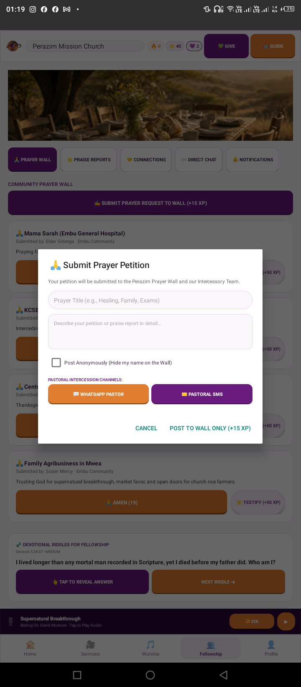
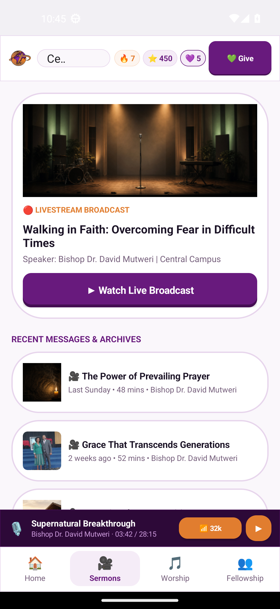
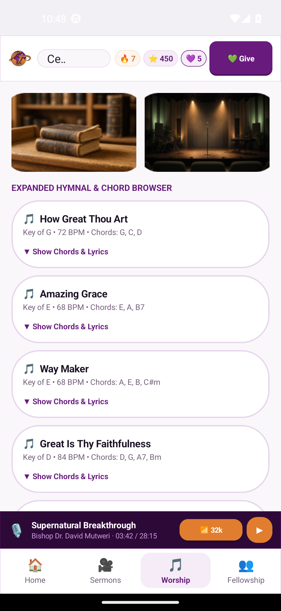
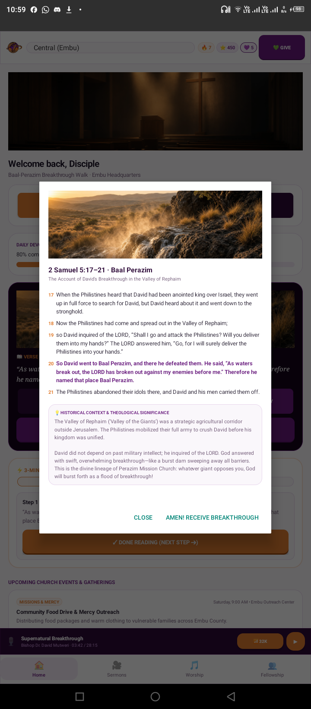

# PERAZIM MISSION CHURCH — Official Android Application

[](https://github.com/lmurugu/perazim-android/actions)
[](https://developer.android.com)
[-purple.svg)](https://github.com/lmurugu/perazim-android)
[](https://www.oracle.com/java/)
[](LICENSE)
[](https://github.com/lmurugu/perazim-android)

> **Motto**: *“The Place of Great Breakthrough”*  
> **Slogan**: *“A place where everybody is somebody, and no body is a nobody”*

---

## 🏛️ Church Foundation & Canonical Identity

**PERAZIM MISSION CHURCH** is established on the covenant foundation of David's breakthrough at Baal-Perazim (*“As waters break out, the LORD has broken out against my enemies before me” — 2 Samuel 5:20*), headquartered in Embu, Kenya, and reaching the global community.

- **Church Name**: **PERAZIM MISSION CHURCH**
- **Motto**: *“The Place of Great Breakthrough”*
- **Slogan**: *“A place where everybody is somebody, and no body is a nobody”*
- **Vision**: *“To be a Center for Missions”*
- **Mission Statement**: *“Perazim exists to draw people to Christ, to disciple them to belong to His family, and to have them glorify GOD with their lives and their services.”*
- **Core Values**: `Evangelism` • `Discipleship` • `Fellowship` • `Worship` • `Ministry`

---

### Leadership & Secretariat Attribution
- **Presiding Bishop**: **Dr. David Mutweri**  
- **Bishop Direct Phone**: `(+254) 0710 772 227`  
- **Bishop Direct Email**: `bishop@perazimchurch.org`  
- **Church Secretariat Email**: `info@perazimchurch.org`  
- **Central Headquarters**: Embu, Kenya  
- **Safaricom Paybill**: `4069983`  
*Perazim Mission Church Global Ministries*

---

## 📱 Visual Showcase (100-Member Pilot on Physical Device)

| Home & Daily Routine | Lipa na M-Pesa Giving | Profile & Pastoral Suite | Prayer Petition & WhatsApp Intercession |
| :---: | :---: | :---: | :---: |
| <a href="docs/screenshots/live_screen_home.png"></a> | <a href="docs/screenshots/live_screen_giving_modal.png"></a> | <a href="docs/screenshots/live_screen_profile.png"></a> | <a href="docs/screenshots/live_screen_prayer_dialog.png"></a> |

| Sermons & Media Stream | Worship & Chords | Scripture Reader |
| :---: | :---: | :---: |
| <a href="docs/screenshots/live_screen_sermons.png"></a> | <a href="docs/screenshots/live_screen_worship.png"></a> | <a href="docs/screenshots/live_screen_passage.png"></a> |

---

## ✨ Feature Highlights

- 💚 **Safaricom M-Pesa Giving (3-Tier Cascade)**: Integrated Safaricom M-Pesa integration targeting Paybill `4069983`. Copies Paybill and account code to clipboard, checks and opens the Safaricom M-Pesa App or SIM Toolkit (`com.android.stk`), with immediate fallback to the Safaricom `*334#` USSD dialer.
- 💬 **Pastoral Care via WhatsApp**: Direct one-tap messaging to Presiding Bishop Dr. David Mutweri (`+254710772227`) for private prayer petitions, counseling, and pastoral support.
- ✉️ **Offline Pastoral SMS**: Formatted SMS intercession link via `smsto:+254710772227` ensuring congregants without active internet bundles can immediately submit urgent prayer needs.
- 📍 **Sanctuary Directions (Google Maps)**: One-tap deep-link intent (`geo:0,0?q=Perazim+Mission+Church+Embu`) guiding congregants directly to Perazim Headquarters in Embu.
- 🛠️ **In-App Feedback & Issue Reporting**: Direct channel connecting pilot members with the App Administrator via WhatsApp with device model, Android OS version, and app version diagnostics prefilled.
- 📖 **Offline Multi-Translation Holy Bible**: Complete offline biblical library containing 5 translations (King James Version, Swahili SUV, NIV, ESV, NKJV) backed by Room SQLite with instant sub-millisecond retrieval.
- ⚡ **Dynamic 3-Minute Breakthrough Routine**: Habit-building devotional module (Read Word, Reflect, Pray) that dynamically updates progress (`0%` -> `33%` -> `66%` -> `100% / +40 XP`), backed by streak tracking and Grace Tokens.
- 🤖 **On-Device AI Breakthrough Guide**: Offline conversational assistant routing members through scriptures, giving guidance, hymns, and fellowship without external cloud API dependencies.
- 🎵 **Hymnal & Chord Browser**: Offline hymnal library featuring chord charts (guitar and piano) for timeless hymns, Swahili choruses, and contemporary worship songs.

---

## 🏛️ Architecture & Tech Stack

- **Application ID & Namespace**: `org.perazimchurch.app`
- **Core Language**: Java 11 / Java 21 LTS
- **Persistence Layer**: Room SQLite (`androidx.room:room-runtime:2.6.1`) for users, prayers, offline sermons, bookmarks, and Bible verses.
- **Intent Orchestration**: `ChurchIntentManager.java` managing all native Android OS handoffs (M-Pesa, WhatsApp, SMS, Calls, Maps, Share Sheet).
- **Target SDK**: Android 34 (Android 14) with backward compatibility down to Android 7.0 (API 24).
- **Security & Privacy**: ProGuard/R8 rules enabled; sensitive credentials and keystores excluded from version control.

---

## 🛠️ Build & Installation Guide

### Prerequisites
- **Java Development Kit**: JDK 21 or JDK 17
- **Android SDK**: Build-tools `34.0.0`, Platforms `android-34`
- **Gradle**: Gradle 8.5+ (Wrapper included)

### 1. Building the Debug APK
```bash
git clone https://github.com/lmurugu/perazim-android.git
cd perazim-android

./gradlew assembleDebug

# Output APK: build/outputs/apk/debug/app-debug.apk
```

### 2. Building the Signed Production Release APK (100-Member Pilot)

For a production release, the APK must be signed with a persistent release keystore so that future updates can install cleanly over previous versions without signature mismatch errors.

#### Keystore Setup
1. Generate your production release keystore (keep this safe and backed up):
```bash
keytool -genkeypair -v -keystore /path/to/perazim-release.jks \
  -alias perazim-release \
  -keyalg RSA \
  -keysize 2048 \
  -validity 10000 \
  -dname "CN=Perazim Mission Church, OU=IT Ministry, O=Perazim Mission Church, L=Embu, ST=Eastern, C=KE"
```

2. Configure `keystore.properties` in your project root (this file is excluded by `.gitignore`):
```properties
storeFile=/path/to/perazim-release.jks
storePassword=YOUR_STORE_PASSWORD
keyAlias=perazim-release
keyPassword=YOUR_KEY_PASSWORD
```

3. Build the signed release APK with Gradle:
```bash
./gradlew assembleRelease

# The signed production APK will be located at:
# build/outputs/apk/release/app-release.apk
```

### 3. Deploying to Physical Device via ADB

```bash
# Verify connected device
adb devices

# Install Signed Release APK
adb install -r build/outputs/apk/release/app-release.apk

# Launch App
adb shell am start -n org.perazimchurch.app/.MainActivity
```

---

## 📂 Project Structure

```
perazim-android/
├── docs/
│   └── screenshots/
│       ├── live_screen_home.png
│       ├── live_screen_giving_modal.png
│       ├── live_screen_profile.png
│       ├── live_screen_prayer_dialog.png
│       ├── live_screen_passage.png
│       ├── live_screen_sermons.png
│       └── live_screen_worship.png
├── src/main/
│   ├── AndroidManifest.xml
│   ├── assets/              # Offline church banners, campus art, hymnal chords
│   ├── java/org/perazimchurch/app/
│   │   ├── MainActivity.java
│   │   ├── ai/              # On-device AI Breakthrough Guide
│   │   ├── data/            # Room SQLite database, DAOs, repositories, mappers
│   │   ├── domain/          # Clean architecture domain models
│   │   ├── navigation/      # ChurchIntentManager (M-Pesa, WhatsApp, SMS, Maps)
│   │   └── presentation/    # UI binders, ViewModels, and dialogs
│   └── res/                 # Vector drawables, themes, strings
├── build.gradle
├── keystore.properties      # Local signing config (gitignored)
└── settings.gradle
```

---

## 📄 License

This project is licensed under the MIT License — see the [LICENSE](LICENSE) file for details.  
Copyright © 2026 Perazim Mission Church & Contributors.
