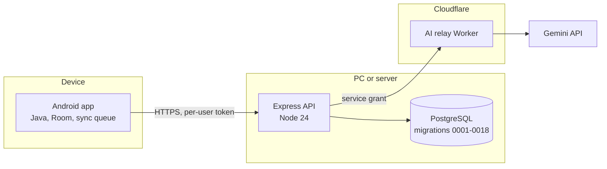

# Perazim

A church companion app for Perazim Mission Church (Embu, Kenya): scripture, sermons, worship, prayer and community, built to work offline first.

> **Status:** pilot in development. Not yet released to the public. See [Status](#status).

## Architecture



- **Android client** (`src/`): offline-first. Content and user actions are stored on the device in Room, and changes are queued and synced when the server is reachable. Session tokens are kept in the Android Keystore.
- **Backend** (`server/`): Express routes and modules for accounts, prayer, community, membership, privacy and AI governance. The database is built from ordered, checksum-verified migrations at startup.
- **AI relay** (`relay/`): a Cloudflare Worker that forwards authorised requests to Gemini and keeps the provider key out of the app. Disabled in release builds.

## Engineering highlights

- **Offline-first sync:** queued mutations with idempotency receipts (migration 0018) and replay on reconnect.
- **Safe migrations:** a migration runner with an advisory lock, checksum drift detection and gap detection. Tests run only against disposable databases.
- **Privacy by design:** versioned privacy notices with acknowledgement records, consent purposes, data-subject requests (access, correction, erasure), and erasure that removes content and disables sign-in.
- **Hardening:** `helmet` headers, default-deny CORS, 100 KB request limit (uploads have their own limit), per-IP and per-account rate limits, bcrypt cost 12, 6-digit PINs, random identifiers, and step-up TOTP for administrators.
- **Governed AI:** knowledge sources need approval before use, and responses carry source references.

## Tech stack

| Area | Technology |
|---|---|
| Android | Java 11, Room 2.6, Android Gradle Plugin 8.9.1, Gradle 8.11.1, compileSdk/targetSdk 36 |
| Backend | Node.js 24, Express 4, PostgreSQL 16, bcryptjs, jsonwebtoken, helmet, express-rate-limit |
| Relay | Cloudflare Workers, Gemini API |
| Operations | Docker, Caddy (TLS), encrypted nightly backups (AES-256, PBKDF2) |

## Quick start

**Android** (requires JDK 17 and the Android SDK):

```bash
./gradlew testDebugUnitTest
./gradlew assembleValidation -Pperazim.apiBaseUrl=https://your-server.example
```

Copy `gradle.properties.example` to `~/.gradle/gradle.properties` and set the server address for each build type. Release builds refuse to build without an HTTPS address.

**Backend** (requires Node 24 and PostgreSQL 16):

```bash
cd server
npm ci
export DATABASE_URL=postgres://user@127.0.0.1:5432/your_disposable_db
export JWT_SECRET=$(openssl rand -hex 32)
npm start
```

Use a disposable local database for development. The server refuses to start without a database in production mode.

**Relay:** see `relay/README.md`.

## Tests

- **Android unit tests:** `./gradlew testDebugUnitTest`
- **Backend:** `cd server && npm run test:unit`, and `npm run test:privacy` against a disposable PostgreSQL database
- **Isolated database suites:** `server/scripts/test-phase-b-isolated.sh` creates and removes its own temporary PostgreSQL cluster

## Repository layout

```
src/              Android app (Java)
server/           Express API, migrations, tests, deployment files
relay/            Cloudflare Worker for the AI relay
docs/             Architecture notes, legal drafts, security audit, product plans
scripts/          Asset and content build tools
```

## Status

- The app and backend run together on a single PC for a closed pilot with a small group of testers.
- Public deployment, app-store release and hosted infrastructure are not done.
- The security audit is partial. Its findings and their status are in [`docs/security/audit-2026-11.md`](docs/security/audit-2026-11.md).
- The privacy policy is a draft awaiting review. See [`docs/legal/`](docs/legal/).

## About the client

Perazim Mission Church, Embu, Kenya. The app is built for the church's members, and church contact details come from one configuration file (`src/main/java/org/perazimchurch/app/config/ChurchConfig.java`).

## Licence

Code is licensed under the MIT Licence (see [`LICENSE`](LICENSE)). Bible texts, hymns and media assets are not covered by that licence. Their status is recorded in [`docs/bible-source.md`](docs/bible-source.md).
