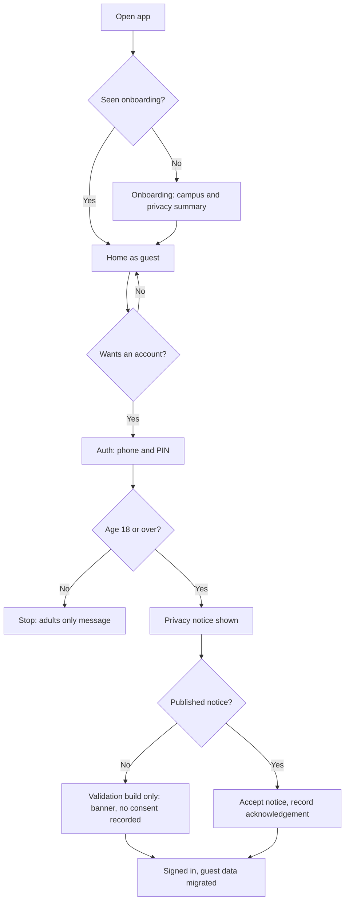
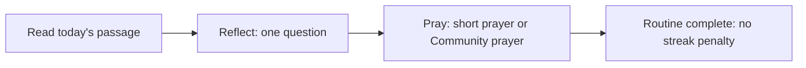
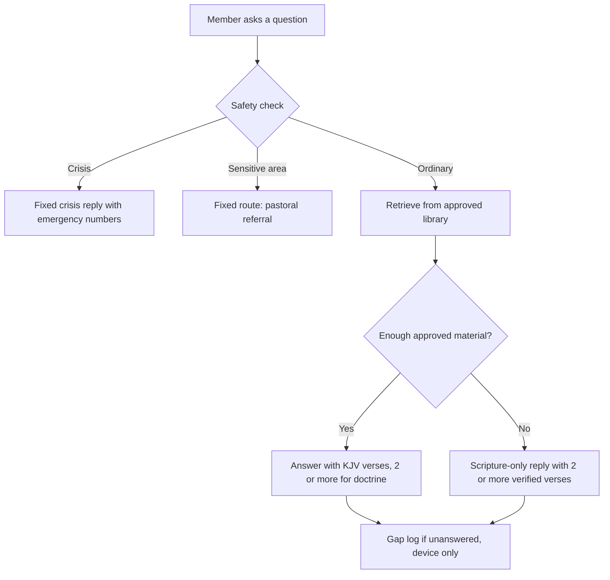
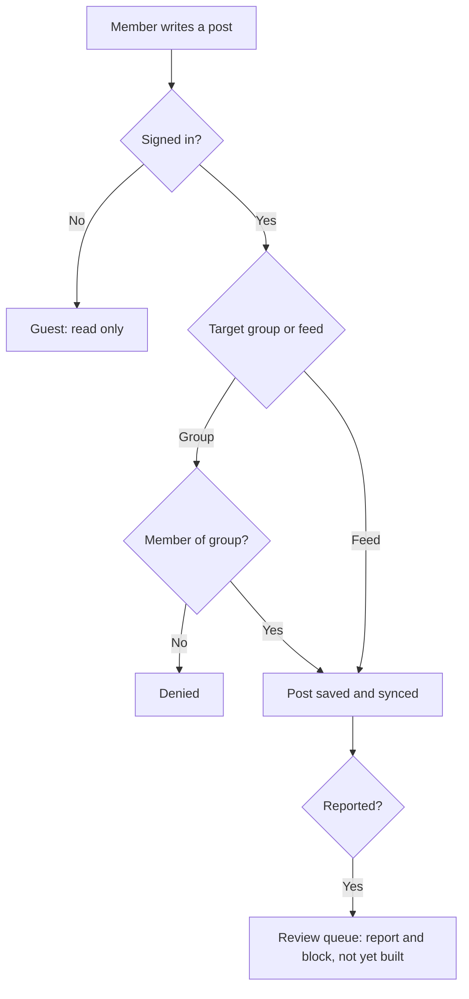
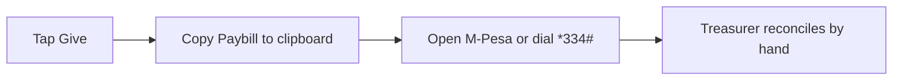
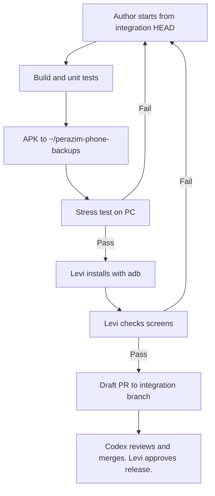

# Perazim Android: Master Plan

**Owner and sole approver:** Rev. Levi Murugu (Perazim Mission Church, PMCI)
**Prepared:** 2026-11-27, from the repository, the handover files and the open pull requests
**Status:** Working master plan. Nothing in this document is approved until Levi marks it. Theology, product and release decisions stay with Levi.
**Where it lives:** `docs/plan/MASTER_PLAN.md` in `perazim-android` (branch `claude/project-thread-eg17po`), the working copy `/mnt/project-files/plan/perazim-master-plan.md`, and the published page. The repository copy is the source. The build steps are in `docs/plan/BUILD-STEPS.md` and the commit log in `docs/plan/BUILD-LOG.md`, which GitHub appends to automatically.

---

## 0. How to read this document

Every statement carries one of these labels:

| Label | Meaning |
|---|---|
| **[V] Verified** | I read it in the repository or in a file. The commit is given where it matters. |
| **[R] Reported** | It comes from a handover note, a thread or a readiness file. I did not check it in code. |
| **[T] Target** | How the app and its work should be done. This is the standard we are aiming for. |
| **[D] Decision** | Levi must decide. Agents do not decide it. |

Commits referenced:

- `codex/community-integration` at `19c2b17`. This is the integration branch and the base for every phone build. Codex is its only writer.
- `main` at `51a7952`. This is 837 commits behind the integration branch. Nothing on `main` is missing from the integration branch.
- The local clone used for this survey is `claude/project-thread-eg17po`, which matches `main`.

---

## 1. Vision and ideas

Perazim is a free Bible-centred app for the members and friends of Perazim Mission Church. It helps people read Scripture every day, pray with their church family, hear sermons, worship, give, and ask honest questions about the faith. It works offline first, so a member with a weak connection in Embu or on a satellite campus can still read, pray and learn.

The app has five ideas that shape every feature:

1. **Scripture first.** The Bible is the centre of each screen. Quotes come from public domain or licensed texts that the church has approved. The AI never quotes from memory.
2. **Offline first.** Reading, games, the Bible search, the daily routine and the cached sermons work without a network. The server adds accounts, community and sync. It never gates the core reading.
3. **Gentle, not manipulative.** No ads, no loot boxes, no paid energy, no streak guilt, no forced losses, no third-party analytics. Missing a day costs nothing.
4. **Safe for children and vulnerable adults.** The church has children in its community. Accounts are for adults (18 and over, approved 2026-11-18). Safeguarding and privacy rules come before engagement.
5. **Church-owned.** Data stays on the church's own server. Doctrine belongs to the church's leadership, and the sole approver is Levi.

### 1.1 Idea backlog (as of 2026-11-27)

| Idea | Status | Source |
|---|---|---|
| Daily Reading with routine (Read, Reflect, Pray) | Built on codex branch | [V] `docs/internal/daily-reading-handover.md` |
| Perazim Assistant (offline Bible-centred guide, KJV library) | Built, validation only, gated | [V] `src/main/java/.../ai/` |
| Bible search overview (Webster 1828 and Madan 1902 Swahili dictionary) | Built, dictionary licence pending | [R] thread notes |
| Games tab (Bible games, offline, no money) | Catalog built, several games in review | [V] `domain/games/catalog`, 36 files |
| Community (feed, groups, messages, prayer, events) | Partly built, privacy acceptance pending | [V] `server/src/routes/community.js`; [R] build register v36 |
| Sermons from the church YouTube channel | Built on `main` and integration branch | [V] commits `c297790`..`51a7952` |
| Audiobooks from Google Drive | Requested. Needs folder link. | [R] coordinator notes |
| Membership claims and admin review | Server built, admin UI partly | [V] `server/src/routes/adminMembership.js` |
| Giving through M-Pesa | Copy Paybill and open M-Pesa. No automatic Daraja API. | [R] status file dated 2026-11-03 |
| In-app self-update for sideloaded builds | Future, after the full build | [R] project memory |
| Store releases (Google Play, App Store) | Not ready. Android closer than iOS. | [R] readiness 2026-11-19 |

---

## 2. Goals and success measures

### 2.1 Goals

| # | Goal | What "done" means |
|---|---|---|
| G1 | Members read Scripture daily | Daily reading works offline and the routine is complete in under 3 minutes. |
| G2 | Members can ask faith questions safely | The Assistant answers from the approved library, refuses what it must, and sends people to a pastor for sensitive matters. |
| G3 | Church community works privately | Groups, messages and prayer respect membership rules, and non-members see only what is allowed. |
| G4 | Sermons and worship are easy to reach | Sermons play from YouTube or the fallback feed. Hymns and chords work offline. |
| G5 | Giving is simple and honest | Members can give with M-Pesa. Nothing pretends to be an automatic payment system until one exists. |
| G6 | The data is safe | Secrets are rotated, the database uses SCRAM, the privacy notice is published with Levi's approval, and deletion works. |
| G7 | Releases are reliable | Every phone build is recorded, stress tested on the PC, and installed by Levi. |

### 2.2 Gates before a pilot (20 to 50 adults)

- Safety and privacy tests at 100 percent (self-harm, harm to others, overdose, weapons with intoxication, privacy in code, health). Zero malformed answers.
- Doctrine and verse search at 98 percent or higher. Zero fabricated Scripture. Other AI categories at 90 percent or higher.
- Privacy notice v0.2 approved and published by Levi. [D]
- Pastoral Care Contact named by Levi. The app never invents it. [D]

---

## 3. Principles (the rules every feature follows)

1. **Levi approves theology, product and release.** AI agents prepare drafts, mark them "under review" or "undecided", and never impersonate Levi.
2. **App first.** A fix is built, installed and seen working in the real app before it is committed or pushed.
3. **Stress test on the PC before any phone build.** Only a passing build is offered for install.
4. **Consistent builds.** Every build includes the latest work from both Claude and Codex on the integration branch.
5. **One workstream per branch.** Claude uses `claude/*` branches and opens draft PRs against the integration branch. Codex uses `codex/*`. Nobody force-pushes or rewrites another agent's branch.
6. **Completed features are frozen.** New ideas may add non-contradicting enhancements, but do not restyle finished screens.
7. **Secrets never enter chat, git, logs or docs.** Names of secrets may appear. Values may not.
8. **Real people's data never enters tests or fixtures.** Use synthetic accounts only.
9. **Adults only for accounts and AI.** Children may read and watch public content.
10. **Public domain or licensed texts only.** A translation is used only after its licence is recorded in `SOURCES.txt`.

---

## 4. Feature inventory

Current state reflects the integration branch at `19c2b17` unless stated. Target state is in section 13.

### 4.1 Home

- Hero "Today" card with the daily reading step, a routine box (Read, Reflect, Pray), a daily verse and the Assistant button on the reading card. [V] `HomeUiBinder.java`, commit `2eb2c40`
- Four Sanctuary doors (Bible, Sermons, Worship, Prayer). [R] Infinix hardware note
- Photo tiles and church vignettes per campus (Embu, Mwea, Rombo). [V] `assets/vignettes/`

### 4.2 Bible (reader, search, interlinear)

- Reader dialog with highlights, saved verses, compare and share. [R] PR 38
- Bundled texts in the app: KJV (primary for AI quotes), WEB, ASV and BSB, each with its source note in `src/main/assets/bible/text/SOURCES.txt`. All four are public domain according to their source notes. [V]
- Greek and Hebrew interlinear with Strong's numbers. Sources in `assets/bible/interlinear/` and `assets/bible/strongs/`. [V]
- Bible search and search overview: `SearchOverviewBuilder.java`. [V] Swahili dictionary (Madan 1902) is not yet approved. [R]
- **Text policy conflict.** The AI rule says KJV and NASB only (from the user's own file). The reader keeps ESV, NIV, NKJV and SUV as stated in project notes. [R] The repository assets do not contain ESV, NIV or NKJV on the integration branch. [V] **[D] Levi must confirm which translations the reader keeps.** The remediation plan recommended removing NIV, ESV and NKJV. Swahili Union Version rights are held by the Bible Societies and need confirmation.

### 4.3 Sermons

- Sermon list reads the church YouTube channel feed through `/api/media/church-feed`. When the YouTube key is unset, the endpoint returns 503 and the app falls back to seeded sermons. [V] `mediaFeed.js`, commit `c297790`
- In-app player, church-styled controls, full-screen Now Playing. [V] commits `1b74831`, `4a2f26e`, `51a7952`
- Bible audio streaming from a PC and local audio activity. [R] Bible audio currently served from Levi's PC, which is not a public host.

### 4.4 Worship (hymnal)

- Hymnal with chords, search, chips (Favourites, Worship, Faith, Grace, Praise). Offline. [V] `WorshipUiBinder.java`, `assets/seed/hymns.json`

### 4.5 Community (Fellowship and Prayer)

- Feed with pinned event area, Inbox, new post, member groups, post filters. [V] `CommunityUiBinder.java`; validated on phone build 36 except the API connection. [R] build register
- Server routes: connections, posts, amen, comments, groups and members, direct messages, acknowledgements, media upload (15 MB limit), RSVP, challenge, notifications, profile, classes. [V] `server/src/routes/community.js`
- **Not yet built or verified [R]:** report and block for user content; Groups, Discover and prayer-audience designs; church membership rules for group visibility. Nonmember denial must be tested with synthetic accounts.
- Prayer requests and amen sync through the `sync_queue` and `SyncDispatcher`. [R] verified on hardware in Phase A.

### 4.6 Give

- Copies the church Paybill to the clipboard and opens M-Pesa or `*334#`. [R] 2026-11-03 status
- No automatic Daraja C2B or STK push. Reconciliation is manual by the treasurer. [R]
- Fake giving XP removed. [R]

### 4.7 Me (profile, account, privacy)

- Phone number and 6-digit PIN registration and login. Kenyan phone format. JWT with refresh tokens. [V] `server/src/routes/auth.js`, migrations 0020 and 0021
- Age confirmation 18+ at sign-up, enforced by server migration 0019. [V] and by the app. [R]
- Membership claim, membership dialog and pin upgrade dialog. [V] `MembershipDialog.java`, `PinUpgradeDialog.java`
- Privacy notice acknowledgement and presentation. [V] `privacy.js`, `PrivacyDocumentDialog.java`
- In-app account deletion. [R] and server erasure cascade. [V] `server/src/privacy/erasure.js`
- Campus selector: Embu Headquarters, Nairobi Fellowship, Meru Outreach, Online Campus. [R] 2026-11-03 status. Check the list against `campuses.js` before reuse.

### 4.8 Perazim Assistant (AI guide)

- On-device guide with a KJV library, approved source list, doctrine library and identify-refute template. [V] `src/main/assets/ai/`, `src/main/java/.../ai/library/`
- Offline model: Qwen 0.5B, about 491 MB, downloaded on device. Enabled only in debug and validation builds. [V] `build.gradle` `OFFLINE_QWEN_ENABLED`
- Online AI through a Cloudflare Worker relay to Gemini: built on the server and relay but **off in every build** until gate L7 passes and the provider terms are approved. [V] `ONLINE_AI_ENABLED=false`; [R] provider terms pending
- Gap log: unanswered questions are logged on the device only, with opt-in sharing. [R] PR 87
- Crisis reply is fixed text. Emergency numbers first (999 or 112), then the other lines listed in the crisis library. [R] The library files are `crisis.md` and `crisis-contacts.json` in `assets/ai/library/`; contents not re-read for this plan. The Pastoral Care Contact is not yet named. [D]
- Black-and-white design on the Assistant screen is Levi's own choice. It is an intentional exception to the design rules. [R]

### 4.9 Games

- Catalog of 13 game definitions (plus session and content banks): Vine Words, Lamp Slide, Story Mosaic, Who Am I, Who Said It, Word Search, Memory Match, Mini Crosswords, Testament, Timeline, Road, Ladder of Faith, Verse Builder, Fill the Gap, and others. [V] `domain/games/catalog/`
- Rules: offline, no money, no ads, no engagement tricks, child-safe art, KJV text for quotes, gentle help (hint or mercy option, never a point cost). [V] `docs/games/GAME_DESIGN_CONCEPTS.md`
- Leaderboard is opt-in and adults only, pending safeguarding review. Server route `/api/games/leaderboard`. [V] `routes/games.js`
- Migration numbering: `0022_games_leaderboard.sql` on the integration branch. [V]

### 4.10 Daily Reading

- Offline daily reading plans with resumable progress. [V] commit `a18542c`; `assets/reading/daily-readings.json`
- Reading counts toward the routine's Read step with no extra XP. [R] Levi's decision 2026-11-21

### 4.11 Sync and offline data

- Room database, version 12 on the integration branch. [V] `PerazimDatabase.java`. Exported schemas are in `schemas/`.
- `SyncQueue`, `SyncDispatcher`, `BackgroundSyncWorker` (WorkManager). [V]
- Google Sheets CSV sync (`SheetSyncManager`, `CsvParser`) is the older content path. [V] It is still present. [T] Target: one content path through the server.

### 4.12 Classroom calls

- `ClassroomCallActivity` and `/api/classroom-calls` exist on the integration branch. [V] `main` removed the classroom calls in PR 36. [D] Levi decides whether this feature stays.

---

## 5. Screens and navigation

### 5.1 Tab shell

| Position | Tab | Notes |
|---|---|---|
| 1 | Home | Today card, routine, doors |
| 2 | Sermons | YouTube feed and fallback |
| 3 | Worship | Hymnal |
| 4 | Community | Feed, groups, messages, prayer |
| 5 | Give | Orb button, orange primary action |

Top bar: logo, wordmark "Perazim", profile icon. Mini-player sits above the bottom bar. [V] `MainActivity.java`, `NavigationContract`

### 5.2 Dialogs and full screens

| Screen | Purpose |
|---|---|
| Auth | Sign in, register, phone change, PIN |
| Onboarding | First run: guest mode, campus, privacy |
| Privacy document | Show the published privacy notice |
| Membership | Claim church membership, see its status |
| Pin upgrade | Move from the legacy PIN |
| Bible reader | Read, highlight, compare, share |
| Assistant (chat) | Ask questions, see sources, give feedback |
| Assistant memory | What the guide remembers (opt-in) |
| Games hub | Game cards: icon, Bible character, title, one line, best score, Play |
| Notifications | Community notifications |
| QR connection | Connect a family member or classroom |
| Reflections | Journal entries |
| Sermons, Hymns, Riddles, Jokes | Older full-screen activities, to be merged into tabs |
| Local Bible audio | Audio player |

---

## 6. User flows

### 6.1 First run and sign-in

### 6.2 Daily routine

### 6.3 Asking the Assistant

### 6.4 Community post and privacy

### 6.5 Giving

### 6.6 Release flow for a phone build

---

## 7. Technology stack

### 7.1 Android app

| Area | Current [V] | Target [T] |
|---|---|---|
| Language | Java | Java for now. A Kotlin move is a Levi decision. |
| Build | Gradle, Java. AGP version not re-verified; the remediation summary says 8.2.2. | Upgrade AGP to 8.7 or later and set compile and target SDK together. [R] remediation plan says both were below the Play minimum. |
| SDK | compileSdk 36, targetSdk 36, minSdk 24 (integration branch) | Keep at 36. Record it in one place. |
| Versions | versionCode 5, versionName 2.2.1. Validation builds override to 36. | Every build records its versionCode in the build register. |
| UI | Custom views: `PerazimTheme`, `GlassKit`, `FrostPane`, `Glass`, `GlassPolish`, `SoftShadow`, `UiScale` | One design kit. Remove duplicates. |
| Database | Room 2.6.1, version 12, exported schemas | Migrations numbered and tested. Room 2.8.x is in a Dependabot PR. |
| Background | WorkManager 2.9 | Upgrade with Dependabot PRs 8 and 18 when CI is green. |
| Images | Glide or similar not verified | Keep one image loader. |
| Testing | JUnit, Espresso androidTest, Robolectric 4.14.1 | Robolectric runs in CI. [R] Blocked by a Maven 429 rate limit from the build environment. |
| Offline AI | On-device Qwen 0.5B (validation and debug only) | Release only after gate L7 and Levi's approval. |

### 7.2 Server

| Area | Current [V] | Target [T] |
|---|---|---|
| Runtime | Node 24 Alpine in Docker. Express 4 (`^4.19.2` in `package.json`). | Keep Node LTS. Decide on Express 5 (PR 19). |
| Security middleware | helmet, cors (allow-list), express-rate-limit (in memory), body limits 100 KB and 15 MB for media | Persistent rate-limit store (ADR 0003). |
| Auth | JWT, refresh tokens, PIN with bcryptjs 2.4 (Dependabot PR 14 proposes 3.0). Admin TOTP for admin routes. | SCRAM database login, rotated secrets, admin step-up with TOTP. |
| Database | PostgreSQL 15 in the VPS compose. Migrations 0001 to 0023 on the integration branch. | One numbered migration sequence (see section 9). |
| Deployment | Docker compose with Caddy as TLS front. Pilot runs in a podman container on the PC. [R] | Standalone VPS, Caddy for TLS, backups tested, a permanent domain. [D] |
| Public access | Not public. Quick tunnel planned. [R] | Named Cloudflare tunnel only after the preconditions in section 11. |
| Online AI | Cloudflare Worker relay (`relay/worker.js`) | Off until gate L7 and provider terms are approved. |

### 7.3 Tooling and CI

- GitHub Actions: Android, backend, CodeQL, release, and Dependabot workflows. [V] `.github/workflows/`
- CodeQL: PR 79 has high alerts and is not to be merged. PR 86 has a ReDoS alert in the NAMED_RELATION regex, pending app check. [R]
- Dependabot: 13 bump PRs open (PRs 7 to 19). Batch them weekly, merge only after CI is green and Levi has reviewed any change that affects behaviour.
- Lint baseline is a 339 KB XML file. [V] `lint-baseline.xml`. Target: shrink it.

---

## 8. Design system

### 8.1 Source of truth

- Colour, type, spacing, radius and gradient tokens live in `src/main/java/org/perazimchurch/app/ui/theme/PerazimTheme.java`. [V]
- The design rules file exists as a draft: `docs/design/DESIGN_RULES.md` (PR 92, based on `main`, draft). Until it merges, the copy at `/mnt/project-files/codex-handover/design-rules.md` is the working reference. [V]
- Levi's instruction for this plan: use the design rules, with **Light, Dark and System** modes, and the Assistant's black-and-white design as the intentional exception.

### 8.2 Modes [T]

The app supports three modes, chosen in settings:

| Mode | How it is set | Notes |
|---|---|---|
| Dark (default) | `PerazimTheme.applyMode(false)` | Deep purple canvas, purple frosted cards, orange for one primary action |
| Light | `applyMode(true)` | Lavender canvas, white glass cards, purple text |
| System | Follows the phone's night setting | `applyPreference` reads `UI_MODE_NIGHT` |

**Correction to the draft rules.** The draft says rule 6 ("do not follow the Android system night mode"). That is wrong for the integration branch. `PerazimTheme` already has `CHOICE_SYSTEM`, `CHOICE_LIGHT`, `CHOICE_DARK`. The rules must describe this mode switch before they merge onto that base. [V] `PerazimTheme.java` lines 93–137; [R] protocol section 3

### 8.3 Core palette (dark, exact values) [V]

| Token | Hex | Use |
|---|---|---|
| `COLOR_BG_DEEP` | `#2A0F33` | Canvas, dialog window |
| `COLOR_SURFACE_SOLID` | `#3D1749` | Cards |
| `COLOR_SURFACE_2_SOLID` | `#4F1E5C` | Inputs, chips |
| `COLOR_PURPLE_BRAND` | `#681A7D` | Active nav, links |
| `COLOR_PURPLE_SOFT` | `#A67BB3` | Eyebrow labels |
| `COLOR_ORANGE_BRAND` | `#E17D2F` | The single primary action per screen |
| `COLOR_TEXT_PRIMARY` | `#F5F0F7` | Headings |
| `COLOR_TEXT_SECONDARY` | `#B9A8C0` | Body and metadata |
| `COLOR_STROKE` | `#33FFFFFF` (dark) | Hairlines |

Light values come from `applyMode(true)` in the same file (for example background `#F6EEFA`, primary text `#2A0F33`).

### 8.4 Non-negotiable rules [V, from design rules]

1. Keep the logo `ic_perazim_logo.png` exactly as it is.
2. Never change the soft pink light gradient of the light game canvas (`#FBEFF8` top left, `#F8DBD7` top right, `#E0B1EB` bottom).
3. Completed features are frozen.
4. Frosted purple with orange accents is the house look. One orange primary per screen.
5. Use tokens, not hex literals, in new code.
6. The Assistant screen's black-and-white design is Levi's choice and stays.
7. Typeface is the system default. No custom font without Levi's approval.

### 8.5 Drift to fix [V]

| Item | Draft rules say | Code says | Target |
|---|---|---|---|
| Large radius | Card radius 14 or 16 dp | `RADIUS_LG = 22`, `RADIUS_XL = 28` | Decide one scale, then update the code or the rules |
| Misnamed aliases | Light-named constants hold dark values | `COLOR_PRIMARY_PURPLE`, `COLOR_ACCENT_ORANGE`, `COLOR_WARM_CREAM`, `COLOR_PURPLE_DEEP`, `COLOR_OBSIDIAN`, `COLOR_BG_NEUTRAL`, `COLOR_BORDER_GREY`, `COLOR_ORANGE_BORDER`, `COLOR_ORANGE_TINT`, `COLOR_PURPLE_TINT`. About 183 references on the integration branch. | Rename to dark tokens (PR 96 is a draft with this change). Build 38 removed five and is awaiting Levi's phone check. [R] |
| Screen constants | Light screens use literal light hex | `BibleReaderDialog`, `MainActivity` and others keep their own literals | Move each screen to tokens after its phone check |

---

## 9. Data model and migrations

### 9.1 Server migrations [V]

- `main` has 0001 to 0021.
- The integration branch adds `0022_games_leaderboard.sql` and `0023_privacy_notice_v02.sql`.
- Other branches have claimed 0022 as well: a store-readiness branch and a resource-catalog branch. [R] The pilot API failed on a "0022_resource_catalog" numbering clash.

**Target:** one sequence on the integration branch. Each new migration takes the next free number when it is merged, not when it is written. The migration runner refuses duplicates. [D] Levi decides whether the resource catalog ships.

### 9.2 Room (app) [V]

- Room version 12 on the integration branch. `MIGRATION_11_12` is registered. [V] A 2026-11-21 handover reports 12 on the separate `feature/offline-qwen-phone` branch. Verify before any new migration.
- Exported schemas in `schemas/` must be committed with each version bump.

### 9.3 Documentation drift [V]

| Document | Says | Repository says |
|---|---|---|
| `STATUS.md` | Version 2.2.0, Room 5, Nov 3 audit | Historic. Marked as historical on `main` by PR 24. |
| Remediation summary | compileSdk 34, AGP 8.2.2 | compileSdk 36 on integration branch |
| Store readiness (Nov 19) | targetSdk 34, Room v5 or v6 | targetSdk 36, Room v12 |

**Target:** one current status file. Older files move to `docs/archive/` with a dated header.

---

## 10. Security and privacy

### 10.1 Secrets [R]

- During the 2026-11-27 session, three secrets were pasted into chat: the JWT signing secret, the admin key and the YouTube API key. **They must be rotated before any public tunnel.** Values are not recorded here.
- Rotation list (names only): JWT secret, database password, admin key (after TOTP re-encryption), YouTube key.
- A script to re-encrypt TOTP secrets and rotate the database password is in draft PR 97. Nothing has been executed.
- Secrets and signing material must never be in git. [V] `.gitignore`; the agent rules forbid them.

### 10.2 Database access [R]

- The pilot database on the PC allows `trust` in `pg_hba`. This was reported in the coordinator's note. It is not in the repository because it lives on the pilot host.
- **Target:** `scram-sha-256` for all local and network connections. Document the `pg_hba` file in the ops runbook.

### 10.3 Application security [V]

- Helmet and a CORS allow-list. Body limit 100 KB. Media upload 15 MB.
- Admin routes use step-up with TOTP. Admin routes must be checked for auth before any public tunnel. [R] checklist in readiness file.
- Login rate limits and register limits. The rate-limit store is in memory. [V] `rateLimiter.js`. **Target:** persistent store.
- Session revocation (migration 0020) and refresh tokens (0021). [V]

### 10.4 Privacy [R]

- Privacy notice v0.2 is in DRAFT and not published. It has open fields: privacy contact email, phone, postal address and policy URL. [V] `server/privacy-notice-v0.2.md`
- Because nothing is published, the presentation route returns 503. Validation logins fail at this step. [R] A client-only validation change is recommended for the interim. The server is not changed.
- A v0.3 publication proposal is written. [R] `readiness/privacy-v0.3-publication-proposal-2026-11-27.md`
- Deletion: server erasure cascade exists. [V] In-app and web account deletion must both be confirmed. [R] web deletion was missing in the Nov 19 readiness.
- Community: report and block are not built. Required for any public store release.

### 10.5 Safeguarding [R]

- Adults only for accounts (18+, approved 2026-11-18).
- Leaderboard and groups for adults only, pending safeguarding review.
- Levi is the interim safeguarding lead.

---

## 11. Environments and operations

| Environment | Where | Purpose | Status |
|---|---|---|---|
| Pilot database | Podman container on the PC, `127.0.0.1:55438`, database `perazim_pilot` | Pilot data (synthetic) | Migrations 0001 to 0023 applied. v0.2 notice DRAFT. [R] |
| Local API | User unit `perazim-api-local-review` from the Codex worktree `server/` | Testing | Running. [R] |
| Public API | Not yet. Named Cloudflare tunnel planned. | Phone access away from home | Blocked by preconditions below. [D] |
| Phones | Levi's phone on validation build 38 (pending his check) | Field testing | [R] |
| CI | GitHub Actions | Build, tests, CodeQL | Android job passes. Emulator jobs not reliable. |

### 11.1 Preconditions before a public tunnel [R]

1. Secrets rotated and old values absent from logs and chat.
2. Local checks pass: `/api/health` returns 200; public community posts return 200; groups return 401 without a token; refresh works.
3. The tunnel targets the API only, never the database.
4. Admin routes confirmed to need auth from the code.
5. The YouTube key stays unset until Levi approves it going through the tunnel.

### 11.2 Build register rules [R]

- Every APK is recorded: versionCode, base commit, changes, tests, phone check.
- A build is "phone verified" only after Levi confirms it.
- The next build after 38 is 39 or higher.

---

## 12. Team and working model

| Role | Who | Works on |
|---|---|---|
| Approver | Levi | Theology, product, release, merges to `main` |
| Integration writer | Codex | `codex/community-integration`, games, daily reading, community, assistant integration |
| Claude | Claude sessions in the project | Bible search, sermons fix, AI engine and safety, design rules, theme rename, planning |
| Build and install | Levi (`adb install -r`) | Phone builds |

Rules: Claude does not push to the integration branch or merge. Codex merges integration work after review. Read-only commands are fine in the other agent's checkout. Neither agent runs reset, checkout, stash or clean in the other's checkout.

---

## 13. Current state versus target (where practice differs)

This section is the core of the plan. It lists each area where the current state is non-standard and the target that replaces it.

| # | Area | Current state [V unless marked] | Target [T] | Decision needed |
|---|---|---|---|---|
| 1 | Branch base | `main` is 837 commits behind the integration branch. PR 45 and 35 still target `main`. | Make the integration branch the release base. Retarget open PRs. | [D] Levi approves the switch |
| 2 | Open PRs | 80 open PRs. Many stacked on other PRs. Several are stale drafts. | Close or merge stale PRs. Each open PR has one owner, one base, one purpose. | [D] which to close |
| 3 | Theme aliases | Five misnamed light aliases hold dark values; about 183 references | Rename to dark tokens (PR 96) | None once phone check passes |
| 4 | Design rules | Rule 6 says ignore system night mode. Code supports Light, Dark, System. | Rules describe three modes | None (agents update the draft) |
| 5 | Radius scale | Draft says 14 or 16 dp. Code uses 22 and 28. | One scale | [D] |
| 6 | Migration numbers | 0022 claimed by three branches | One sequence, number at merge | [D] resource catalog |
| 7 | Database access | `pg_hba` trust on the pilot host [R] | SCRAM for all connections | None |
| 8 | Secrets | Three secrets pasted into chat [R] | Rotated, names only in docs | Levi confirms rotation |
| 9 | Privacy notice | v0.2 DRAFT with open fields. Validation login returns 503. | Levi approves; publish; registration opens | [D] approve v0.2 or v0.3 |
| 10 | Bible texts | Reader keeps ESV, NIV, NKJV, SUV per project notes [R]; assets hold KJV, WEB, ASV, BSB (public domain) | One list approved by Levi with licences in `SOURCES.txt` | [D] |
| 11 | Report and block | Not built [R] | Built before public release | Build |
| 12 | Robolectric | Declared in `build.gradle`; blocked by Maven 429 [R] | CI runs Robolectric | Retry or mirror |
| 13 | Dependency drift | Express 4 to 5 (PR 19), bcryptjs 2 to 3 (PR 14), Room 2.6 to 2.8 (PR 16) open | Batched weekly review | [D] for majors |
| 14 | Store readiness | Not ready for Play or App Store [R] | Ready checklist met | [D] iOS path and account spend |
| 15 | Public hosting | API runs on Levi's PC [R] | Named tunnel first, then VPS | [D] Cloudflare account |
| 16 | Giving | Manual Paybill copy [R] | Daraja only if Levi approves the cost and terms | [D] |
| 17 | Sync content | Google Sheets CSV and server sync both active | One content path | [D] |
| 18 | Doc drift | `STATUS.md`, remediation summary, store readiness out of date | One current status file; older files archived | None |
| 19 | Lint baseline | 339 KB baseline | Shrink over time | None |
| 20 | Admin UI | Admin routes exist; UI partly built [R] | Documented admin provisioning procedure | [D] |
| 21 | Online AI | Built, off | Off until gate L7 and terms | [D] provider terms and costs |
| 22 | Audiobooks | Google Drive public links planned [R] | Church-owned host with a licence | [D] which host |
| 23 | Church name | "Perazim Mission Church" or "PMCI" both in use | One name in the privacy notice and the app | [D] |

---

## 14. Decisions for Levi

Each decision is listed once with a recommendation. Levi chooses. Nothing below is decided by an agent.

1. **Integration branch as release base.** Recommend yes. Retarget PRs, then close stale ones. Options: yes, keep `main` as base, or decide later.
2. **Bible translations in the reader.** Recommend: KJV, WEB, ASV, BSB (public domain, already bundled), plus NASB only from the user's own file. Remove ESV, NIV and NKJV from the reader unless a licence is confirmed. Options: this, keep all, or ask the licensors.
3. **Privacy notice.** Recommend approving v0.2 with the open fields filled, then publishing. Options: approve v0.2, approve v0.3 after its review, or hold.
4. **Radius and card scale.** Recommend the design rules' 14 and 16 dp for cards, updated in code only after the phone check. Options: rules win, code wins, or new scale.
5. **Public hosting.** Recommend a named Cloudflare tunnel now (stable hostname) and a VPS later. Options: named tunnel, quick test tunnel only, or VPS first.
6. **Classroom calls.** Recommend keeping them out of the release until the safeguarding review. Options: remove, keep, or review.
7. **Dependency majors.** Recommend staying on Express 4 until after the pilot. Options: upgrade now, after pilot, or never.
8. **iOS path.** Recommend Android first, PWA as the interim for iPhone users. Options: PWA, native SwiftUI, cross-platform rewrite. Needs a Mac or a decision.
9. **Church name in the app.** Recommend "Perazim Mission Church" in full and "PMCI" in the footer. Options: full name, PMCI, or both.
10. **Tithing, divorce and remarriage, women in ministry.** Still undecided. The AI must answer these as "under review" until Levi decides.
11. **Pastoral Care Contact.** Needs a named person before the distress check goes live.

---

## 15. Roadmap

### 15.1 Now (this week)

1. Rotate the secrets listed in section 10.1. Levi confirms. [D]
2. Client-only validation change so validation sign-in works while the notice is unpublished. Build 39 or later. Stress test on the PC first.
3. Merge the theme alias rename (PR 96) after build 38's phone check.
4. Record the integration HEAD and every build in the build register.
5. Retarget the open PRs to the integration branch. Close stale ones after Levi agrees.
6. Publish the one current status file.

### 15.2 Next (before the pilot)

1. Community privacy acceptance with synthetic accounts: nonmember denial, group rosters, media access.
2. Report and block for community content.
3. Bible search acceptance and the Swahili dictionary licence.
4. SCRAM on the pilot database; admin TOTP re-encryption (PR 97).
5. Safety and doctrine gates at target (section 2.2).
6. Pilot: 20 to 50 adults, Levi approves the cohort.

### 15.3 Later

1. Permanent domain and VPS deployment with Caddy and tested backups.
2. Store readiness: Play data safety, privacy policy URL, account deletion on the web.
3. Daraja giving if approved.
4. In-app self-update for sideloaded builds.
5. Audiobooks from a licensed host.
6. Online AI after gate L7 and provider approval.

---

## 16. Appendix A: repository map

**Android app (`perazim-android`)**

- `src/main/java/org/perazimchurch/app/`: `MainActivity`, activities, `presentation/ui` (binders and dialogs), `ui/theme` (tokens and kit), `ai/` (guide, library, local model, search, remote relay client), `data/` (Room, remote sources, mappers), `domain/` (models, games engine and catalog), `sync/` (queue, dispatcher, CSV).
- `src/main/assets/`: `bible/`, `ai/`, `games/`, `seed/`, `reading/`, `reference/`, `vignettes/`.
- `src/main/res/`: resources, logo.
- `src/test/`, `src/androidTest/`, `src/validation/`.
- `server/`: Express API, migrations, scripts, deploy, tests, privacy notice drafts.
- `relay/`: Cloudflare Worker for online AI, with tests.
- `docs/`: product (voice guide, media consent), legal, phase-b, adr, data-protection, games, review, screenshots.
- `ai-eval/`: evaluation runs, knowledge package, held-out sets.
- `.github/workflows/`: CI.

**Handover and planning files (`/mnt/project-files`)**

- `codex-handover/`: design rules, build register, co-development protocol, handover prompts.
- `readiness/`: store readiness, Cloudflare tunnel, privacy v0.3, validation login 503.
- `ai-rubric-2026-11-25/`, `ai-safety/`, `ai-eval/`: AI evaluation and safety.
- `phone-builds/`: validation APKs and checksums (not in git).
- `reference/`: reference databases (approved and pending).

### Appendix B: open pull requests (80 at 2026-11-27)

Grouped by purpose. Numbers only; check each before acting.

| Group | PRs |
|---|---|
| Coordination and design | 92 design rules (draft, base `main`), 93 co-development protocol (draft), 95 design fixes (draft), 96 theme alias rename (draft) |
| Pilot and operations | 94 reconciliation scripts (draft), 97 TOTP and password rotation scripts (draft) |
| Integration | 91 Community and Bible Search into the integration branch (draft) |
| Assistant and AI | 69, 70, 76, 80, 81, 82, 83, 86, 87 (AI guide, library, evaluation, gap log) |
| Games | 51 to 66, 74, 75, 78, 79, 30, 32 (games engine, content, art, leaderboard) |
| Reader and home | 34, 37, 38, 39, 45 (Bible reader, interlinear, home, design system) |
| Sermons and community | 21, 24, 31, 35, 88 (sync, YouTube feed, community hub, store readiness, sermons fallback) |
| Governance | 67, 68, 71, 72 (AI governance, approver naming, apologetics review, translation policy) |
| Security and server | 28, 26, 27, 36, 50, 85 (relay quota, validation build type, classroom removal, approver signatures, express-rate-limit bump) |
| Dependabot | 7 to 19 (GitHub Actions, Gradle, npm bumps) |
| Docs | 5 (M-Pesa donation security proposal, base `phase-B-community`) |

---

## 17. Appendix C: what this plan did not check

- Code was read from the repository, not run. No build, test or phone check was executed for this plan.
- Items marked [R] were not verified in code.
- The pilot database and its `pg_hba` file live on the PC and were not inspected.
- Online provider terms, costs and licences were not checked.
- PR statuses are as listed on 2026-11-27 and will change.

---

## 18. How this plan is kept current

- **Source:** `docs/plan/MASTER_PLAN.md` in the repository. Changes are made by commit, reviewed in the draft PR, and merged by Levi's decision.
- **Automatic log:** every commit pushed to `claude/project-thread-eg17po` is appended to `docs/plan/BUILD-LOG.md` by the GitHub workflow `.github/workflows/plan-build-log.yml`, which runs `scripts/plan/append-build-log.sh`. The workflow writes only to that log file, skips its own commits with `[skip ci]`, and never writes to the integration branch.
- **Published page:** republished from the repository copy whenever this plan changes. Its link does not change.
- **Rules for updates:** each revision states what changed and why. A decision is marked as made only when Levi records it. A superseded statement is struck through and dated, not deleted.
- **Who updates:** Claude records the plan and working steps. Codex records integration status in its own handover. Levi approves any change that alters a decision.

## 19. Working steps to build the components

The full step list, with the commands the repository already uses, is in `docs/plan/BUILD-STEPS.md`. In short:

1. **Survey** the repository, the integration branch (read only), the handover files and the open PRs. Record what was verified.
2. **Plan** the change in the master plan first, with each claim labelled.
3. **Build** the app in the app-first order: change, build the validation APK, stress test on the PC, then Levi installs it and checks the screens.
4. **Verify** against CI (`testDebugUnitTest`, `assembleDebug`, backend `npm test`) and record the result in the build register.
5. **Commit** only after the app check passes, push to the named branch, and open a draft PR with the attribution lines.
6. **Log** the commit automatically in `docs/plan/BUILD-LOG.md`.
